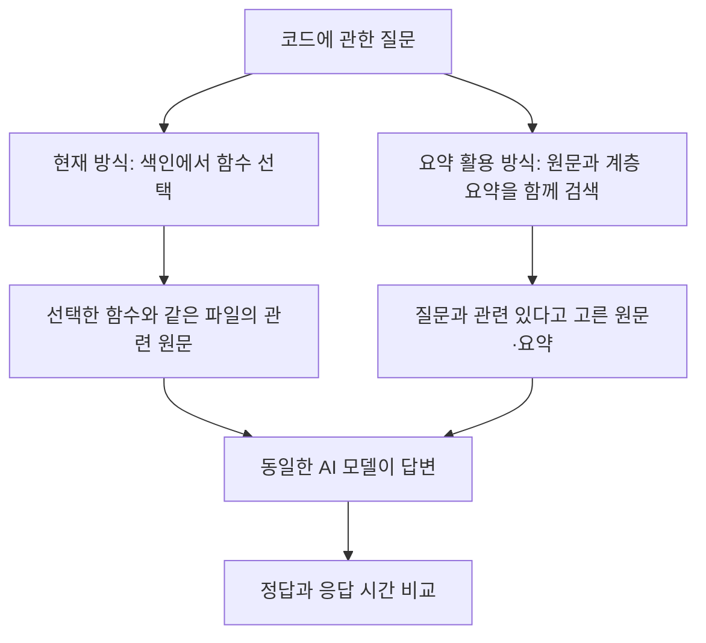

# 코드 검색에 RAPTOR 요약을 더하면 답변이 좋아지는가?

**실험 설계와 결과를 설명하는 상세 보고서**  
실험일: 2026년 10월 20일 · 문서 개정일: 2026년 10월 24일

이 보고서는 **AI가 코드에 관한 질문에 답할 때, 어떤 자료를 찾아서 보여 주는 것이 더 효과적인지** 비교한다. 현재의 `symbol_index` 방식에 여러 단계의 요약을 활용하는 RAPTOR 아이디어를 적용했을 때, 정답 수·응답 시간·준비 비용이 어떻게 달라지는지가 핵심이다.

관측된 정답 수는 조금 늘었지만, **요약 방식이 더 정확하다고 확정할 만큼 근거가 충분하지 않았다.** 후속 실험 48문제에서 현재 방식은 9문제, 계층 요약 방식은 10문제를 맞혔다. 응답 시간은 각각 2.38초와 4.39초였다. 요약 방식의 중복 자료를 정리하면 3.82초로 줄었지만, 현재 방식보다 여전히 느렸다.

짧은 설명부터 보려면 [입문 보고서](02_처음_읽는_symbol_index와_RAPTOR_비교.md)를 참고하면 된다. 아래에서는 비교 대상의 뜻부터 설명한다.

## 1. 무엇이 달라지는 실험인가?

예를 들어 AI에게 “재고 9개 중 일부를 예약하면 판매 가능한 재고가 몇 개 남는가?”라고 묻는다고 하자. 답하려면 재고 계산 함수뿐 아니라 다른 파일의 안전재고 규칙도 알아야 할 수 있다. **AI에게 필요한 코드를 찾아 주는 단계**가 이번 실험의 대상이다.

| 용어 | 이 보고서에서의 뜻 |
|---|---|
| 함수 | 입력을 받아 계산하거나 특정 작업을 수행하는 코드 단위. 여러 함수가 서로 호출하며 하나의 기능을 만든다. |
| `symbol_index` | 함수·클래스 등의 이름과 소스 위치를 정리한 색인. 필요한 코드가 어디 있는지 찾는 **주소록**에 가깝다. |
| 원문 | 프로그램에 실제로 작성된 코드. 요약이 잘못되었는지 확인할 때 기준이 된다. |
| RAPTOR | 작은 내용을 요약하고, 그 요약들을 다시 묶어 상위 요약을 만드는 검색 접근법. 구체적인 내용과 전체 맥락을 함께 찾으려는 목적이 있다. |
| 계층 요약 | 이번 실험에서는 **함수와 관련 코드 → 파일 → 프로젝트 전체** 순으로 만든 요약이다. |
| 답변 근거 | 질문과 함께 AI에게 전달하는 원문·요약 자료. 코드 전체가 아니라 검색으로 고른 일부다. |
| 토큰 | AI가 글을 처리하는 작은 단위. 대체로 전달할 토큰이 많아지면 읽는 시간도 늘어난다. |

답변을 만드는 AI 모델은 고정했다. 질문별로 전달되는 근거가 달라지고, 그 결과 답과 시간이 달라지는지를 측정했다. 코드 수정이나 취약점 탐지 성능을 직접 측정한 실험은 아니다.

**적용 범위:** 여기서 RAPTOR 적용은 코드 구조에 맞춰 만든 변형이다. 함수 의존 관계와 파일을 기준으로 요약을 묶고, 단어의 중요도와 겹침을 이용하는 TF-IDF 검색으로 자료를 고른다. 원래 RAPTOR의 임베딩·군집화 구성 전체를 재현한 것은 아니다. 또한 현재 방식과 요약 방식은 검색 경로도 다르므로, 둘의 차이 전부를 “요약의 효과”로 해석할 수 없다. 이를 구분하려고 중간 비교 방식을 함께 두었다.

## 2. 비교한 여섯 방식과 이전 문서의 표기

**A·B·C·R0·RF·RH는 실험 기록에 붙인 식별자다.** 아래 표에서 한 번 연결해 두고, 본문에서는 의미가 드러나는 이름을 사용한다. `R0`의 마지막 글자는 숫자 0이다.

| 이 보고서의 이름 | 이전 표기 | 실제 동작 | 비교하려는 이유 |
|---|---|---|---|
| **현재 색인 방식** | A | `symbol_index`의 후보에서 AI가 함수를 고르고, 같은 파일의 관련 원문을 가져온다. 요약은 쓰지 않는다. | 현재 검색 방식의 기준점 |
| **파일 간 확장 방식** | B | 현재 방식이 고른 함수에서 시작해 다른 파일의 관련 함수·상수까지 가져온다. 요약은 쓰지 않는다. | 다른 파일까지 찾는 것만으로 개선되는가? |
| **원문 검색 방식** | R0 | 함수별 원문과 관련 코드 묶음을 단어 유사도로 검색한다. 요약은 쓰지 않는다. | 요약 방식과 같은 검색 틀에서, 요약이 없는 기준점 |
| **함수 요약 방식** | RF | 원문 검색 후보에 함수와 관련 코드를 설명하는 요약을 추가한다. | 함수 요약을 추가한 효과가 있는가? |
| **계층 요약 방식** | RH | 원문에 함수·파일·프로젝트 수준의 요약을 모두 더해 검색한다. | 상위 수준 요약까지 추가하면 개선되는가? |
| **계층 요약 정리 방식** | C | 계층 요약 방식과 똑같은 자료를 고른 뒤, 반복 코드·반복 import문을 제거하고 긴 출처 표기를 줄인다. | 같은 자료를 더 짧게 전달하면 빨라지는가? |

현재 색인 방식은 기존 함수 선택·문맥 확장 코드를 재사용했다. 다만 공통 답변 형식과 근거 길이 제한을 추가했으므로, 서비스 전체를 그대로 실행한 성능 수치는 아니다.

계층 요약 정리 방식은 **중복을 제외한 코드·import문·요약 본문을 그대로 보존**한다. 새로 요약하거나, 남는 공간에 자료를 더 넣거나, 검색 순위를 바꾸지 않는다. 그러나 반복·출처 표기·배치가 달라지므로 AI의 답변까지 같아진다는 보장은 없다.

## 3. 실험은 왜 두 번으로 나뉘었나?

첫 실험은 요약의 효과를 확인하기 위한 비교였다. 이후 요약 방식의 입력이 길고 읽는 시간이 크다는 관찰을 바탕으로, 중복을 정리하는 후속 실험을 진행했다.

| 구분 | 1차: 검색 방식 비교 | 2차: 입력 정리 효과 확인 |
|---|---|---|
| 핵심 질문 | 요약을 더하면 정답이 늘어나는가? | 계층 요약의 자료를 정리하면 더 빨라지는가? |
| 비교 방식 | 현재 색인·파일 간 확장·원문 검색·함수 요약·계층 요약 | 현재 색인·계층 요약·계층 요약 정리 |
| 평가 문제 | 48문제 | 같은 프로젝트에서 만든 새 48문제 |
| 반복 | 각 문제·방식별 3회, 총 720답변 | 각 문제·방식별 3회, 총 432답변 |
| 시간 측정 | 공유한 함수 선택 비용 등을 합산한 기록값 | 각 요청의 검색 시작부터 답변 완료까지 직접 측정 |

두 실험 모두 가격 계산·권한 확인·라우팅·재고·캐시·일정이라는 **6개 소규모 합성 Python 프로젝트**를 사용했다. 프로젝트당 파일 5개, 평가 문제 8개다. 프로젝트의 기본 구조가 비슷하므로 실제 서로 다른 대형 저장소를 대표한다고 볼 수는 없다.

문제는 단일 함수 6개, 여러 파일 연계 12개, 경계 조건 6개, 동작을 자연어로 설명한 질문 12개, 변경 영향 6개, 구조 파악 6개로 구성했다. 질문은 영어다. **2차의 새 문제도 이미 본 프로젝트에서 만들었고, 출제 시점에 1차 결과가 알려져 있었다.** 독립된 새 프로젝트에서의 검증은 아니다.

### 공정하게 비교하기 위해 고정한 것

| 항목 | 조건 |
|---|---|
| 답변 모델·장비 | Qwen2.5-Coder-7B-Instruct Q5_K_M · Apple M3 Pro, 메모리 36 GiB |
| 근거 길이 | 최대 1,024토큰. 상한이 같을 뿐, 각 방식이 실제로 사용한 양은 다르다. |
| 답변 조건 | 같은 답변 지시문, 출력 최대 128토큰, temperature 0, seed 1 |
| 정답 판정 | 정답 값·자료형·요구한 목록 순서까지 일치해야 정답. 응답은 JSON이라는 정해진 데이터 형식으로 제출한다. |
| 2차 실행 순서 | 세 방식의 여섯 가지 실행 순서를 반복별로 균등 배치하고, 문제 실행 순서를 무작위화 |
| 2차 재사용 통제 | 현재 색인의 함수 선택도 매번 실행. 이전 입력의 모델 계산 결과를 재사용하는 기능을 끄고, 토큰 수 계산 캐시는 요청마다 비움. |

3회 반복은 속도와 출력의 안정성을 확인하기 위한 것이다. 각 문제·방식의 답은 세 번 모두 같았다. 따라서 **144번 답변했다고 독립된 144문제를 푼 것으로 계산하지 않고, 정답 수는 48문제 기준**으로 제시한다.

## 4. 1차 결과: 요약 자체가 도움이 되었나?

| 방식 | 정답 수 / 48문제 | 정답률 | 현재 색인 대비 정답 수 차이 |
|---|---:|---:|---:|
| 현재 색인 | 8 | 16.7% | 기준 |
| 파일 간 확장 | 12 | 25.0% | +4문제 |
| 원문 검색 | 12 | 25.0% | +4문제 |
| 함수 요약 | 9 | 18.8% | +1문제 |
| 계층 요약 | 9 | 18.8% | +1문제 |

자료: [1차 집계 결과](evidence/analysis.json). 이 표는 아래 2차 표와 **문제가 다르다.**

현재 색인과 계층 요약을 비교하면 정답은 1문제 늘었다. 그러나 같은 검색 틀의 **원문 검색과 계층 요약을 비교하면 오히려 3문제 줄었다.** 함수 요약에 파일·프로젝트 요약을 더해도 전체 정답 수는 같았다. 즉, 이번 구현에서 “요약을 추가했기 때문에 더 잘 답한다”는 효과를 확인하지 못했다.

관측상 가장 높은 점수는 요약을 쓰지 않은 파일 간 확장과 원문 검색이었다. 이는 다른 파일의 원문을 잘 찾는 작업을 우선 검토할 이유가 된다. 다만 6개 프로젝트뿐이며, 파일 간 확장은 원문의 표시 형식도 현재 방식과 달라 **파일 탐색 범위 하나만의 효과를 완전히 분리한 실험은 아니다.**

## 5. 2차 결과: 계층 요약의 입력을 정리하면 얼마나 달라지나?

### 새 48문제에서의 핵심 결과

| 방식 | 정답 수 / 48문제 | 정답률 | 대표 응답 시간 | AI에게 준 근거 길이 |
|---|---:|---:|---:|---:|
| 현재 색인 | 9 | 18.8% | **2.38초** | 평균 101토큰 |
| 계층 요약 | 10 | 20.8% | 4.39초 | 평균 1,015토큰 |
| 계층 요약 정리 | 11 | 22.9% | 3.82초 | 평균 817토큰 |

자료: [2차 집계 결과의 새 문제 집합](evidence/revision_v2/summary_v2.json). 대표 응답 시간은 **문제별 세 번 측정의 중앙값을 구한 뒤, 48문제에 걸쳐 평균한 값**이다. 모델을 이미 실행해 둔 상태의 검색·답변 시간이며, 모델 시작과 요약 생성 시간은 포함하지 않는다.

| 비교 | 정답 수의 변화 | 시간의 변화 | 해석 |
|---|---|---|---|
| 현재 색인 → 계층 요약 | 9 → 10, **+1문제** | 2.38 → 4.39초, **84.8% 더 오래 걸림** | 작은 점수 차이에 비해 시간 부담이 큼 |
| 계층 요약 → 계층 요약 정리 | 10 → 11, **+1문제** | 4.39 → 3.82초, **13.1% 단축** | 계층 요약 방식의 속도 개선 효과가 관측됨 |
| 현재 색인 → 계층 요약 정리 | 9 → 11, **+2문제** | 2.38 → 3.82초, **60.6% 더 오래 걸림** | 정리한 뒤에도 현재 색인이 가장 빠름 |

퍼센트는 반올림 전 시간으로 계산했다. “13.1% 단축”의 비교 기준은 **정리 전 계층 요약**이며, 현재 색인보다 빨라졌다는 뜻이 아니다.

### 정답 수가 늘었으니 더 정확하다고 말할 수 있나?

아직은 어렵다. 48문제 중 1문제 차이는 정답률 **2.1%p** 차이다. `%p`는 두 정답률의 단순 차이로, 예를 들어 20.8%에서 22.9%로의 변화다. 프로젝트를 단위로 다시 뽑아 계산한 탐색적 95% 구간은 다음과 같다.

| 비교 | 관측된 정답률 차이 | 차이의 95% 추정 구간 |
|---|---:|---:|
| 계층 요약 − 현재 색인 | +2.1%p | −4.2 ~ +8.3%p |
| 계층 요약 정리 − 계층 요약 | +2.1%p | −4.2 ~ +8.3%p |
| 계층 요약 정리 − 현재 색인 | +4.2%p | −6.3 ~ +14.6%p |

세 구간 모두 음수와 양수를 포함한다. 이 표본으로는 개선과 악화를 명확히 구분하기 어렵다. **더 정확하다는 증명도, 정확도가 같거나 유지된다는 증명도 아니다.** 특히 프로젝트가 6개뿐이므로 구간 자체도 탐색적으로 해석해야 한다.

계층 요약을 정리했을 때 2문제는 오답에서 정답으로, 1문제는 정답에서 오답으로 바뀌었다. 나머지 45문제는 정오 판정이 같았다. “+1문제”는 이 변화의 순합계다.

### 시간과 준비 비용은 어떻게 봐야 하나?

근거 길이는 정리 전보다 **19.4%**, 질문·지시문을 포함한 전체 입력은 **16.9%** 줄었다. AI가 입력을 읽는 시간도 **16.9%** 줄어, 응답 시간 단축이 입력 감소와 함께 나타났다. 대표 응답 시간 단축률 13.1%의 탐색적 95% 구간은 **11.1~15.1%**였다. 이는 이 장비·실행 세션·문제 구성에서의 결과다.

느린 요청까지 같은 비율로 좋아진 것은 아니다. 전체 요청 중 95%가 끝나는 시간인 **p95**는 계층 요약 5.22초, 정리 방식 5.12초로 약 **1.9%**만 줄었다. 현재 색인의 p95는 3.17초였다.

별도로, 평가용 6개 프로젝트의 요약 121개를 처음 만드는 데 **약 9.5분, 프로젝트당 평균 95초**가 들었다. 2차에서는 이 요약을 재사용했다. 이 비용은 위 응답 시간에 들어 있지 않으며, 모델 로딩 등 모든 초기 준비 비용을 포함한 수치도 아니다. 코드 변경 뒤 요약 갱신 비용과 비용 회수 시점은 이번 결과로 판단할 수 없다.

## 6. 실제 답변은 어떻게 달라졌나?

### 사례 1: 정리 후 맞힌 재고 계산

질문은 `remaining_after(9, 1, 8, True)`의 반환값이다. 재고 9개에서 이미 잡힌 1개와 안전재고 3개를 빼면 처음 판매 가능량은 5개다. 요청은 8개지만 부분 예약을 허용하므로 5개를 예약한다. 따라서 남는 판매 가능량은 **0개**다.

| 현재 색인 | 계층 요약 | 계층 요약 정리 | 정답 |
|---:|---:|---:|---:|
| 8 · 오답 | 5 · 오답 | **0 · 정답** | 0 |

정리 전후에 고른 자료와 고유 본문은 같았지만 답은 달라졌다. 중복 제거와 출처 표기 축약 중 어느 변화가 정답을 만들었는지는 따로 분리해 실험하지 않았다.

### 사례 2: 정리 후 반환 형식을 틀린 권한 확인

질문은 `can_edit_own('owner', ['document:write'], 200, 3799)`의 반환값이다. 필요한 권한이 있고 세션 경과 시간 3,599초가 제한 3,600초보다 작으므로 참/거짓 값인 **`true`**가 정답이다.

| 현재 색인 | 계층 요약 | 계층 요약 정리 | 정답 |
|---|---|---|---|
| `true` · 정답 | `true` · 정답 | `"allowed"` · 오답 | `true` |

문자열 `"allowed"`도 허용을 뜻하지만 함수의 실제 반환값과 자료형이 달라 오답으로 채점했다. 이 사례를 곧바로 “권한 논리를 이해하지 못했다”는 증거로 해석해서는 안 된다. **이번 점수에는 내용뿐 아니라 요구한 반환 형식을 지키는 능력도 반영된다.** 두 사례의 질문·정답·출력은 [2차 집계의 examples](evidence/revision_v2/summary_v2.json)에 보존되어 있다.

## 7. 이 결과로 어디까지 판단할 수 있나?

| 확인된 사실 | 해석의 한계 |
|---|---|
| 후속 실행의 기록·선택 자료·토큰 수 등 37개 무결성 점검을 통과했다. 별도 계산으로 집계값 618개가 일치했다. | 기록의 일관성을 확인한 것이다. 실험이 실제 서비스 전체를 대표하거나, 요약 내용이 모두 사실이라는 보장은 아니다. |
| 정리 전후 고른 자료가 같고, 중복을 제외한 원문·요약 본문이 보존되었다. | 입력의 표시와 반복이 바뀌므로 정답률 보존을 보장하지 않는다. |
| 세 방식의 새 문제 정답률이 18.8~22.9%였다. | 절대 성능이 낮다. 특히 동작을 자연어로 설명한 12문제는 세 방식 모두 실패했다. |
| 작은 합성 Python 프로젝트, 영어 질문, 한 모델·한 장비에서 측정했다. | 실제 대형 저장소, 한국어 질문, 다른 모델, 코드 수정·보안 분석으로 일반화할 수 없다. |
| 원래의 48문제도 후속 방식으로 별도 재확인했다. | 이미 결과를 아는 문제이므로 새 문제와 합쳐 성능 근거를 늘리지 않았다. |

요약 내용의 오류도 실제로 발견되었다. 예를 들어 `canonical_query` 요약에는 URL 인코딩을 한다는 설명이 있었지만, 원문은 문자열을 이어 붙였다. 이 오류가 특정 채점 실패의 원인인지까지는 검증하지 않았다. 따라서 “원문에서 만든 요약”이라는 이유만으로 요약을 정답 근거로 신뢰해서는 안 된다.

## 8. 프로젝트에 대한 판단

**현재 결과만으로 현재 색인 방식을 계층 요약 방식으로 교체할 근거는 부족하다.** 현재 색인이 가장 빠르고, 계층 요약의 정답률 이득은 확실하지 않다.

요약 방식을 계속 개발한다면, 중복과 긴 출처 표기를 정리하는 방법은 검토할 가치가 있다. 이번 조건에서는 약 0.58초, 13.1%의 시간 절약이 관측되었다. 다만 정확도 유지 여부를 더 큰 독립 평가로 확인해야 한다.

다음 평가에서는 실제 서로 다른 저장소를 고정한 뒤, **현재 색인 → 파일 간 확장 → 같은 검색에 요약 추가 → 입력 정리**를 단계별로 비교하는 것이 적절하다. 반환 형식 준수와 내용 정답을 나누어 보고, 질문 종류별 점수·느린 요청의 시간·요약 갱신 비용도 함께 측정해야 어떤 개선이 실사용에 가치가 있는지 판단할 수 있다.

## 부록: 측정 세부 사항과 확인 자료

- **시간 범위:** 2차는 검색·함수 선택·자료 묶기·토큰 계산·입력 정리·답변 호출 및 작은 로그 기록 비용을 포함한다. 모델 시작, 사전 검색 자료 준비, 채점은 제외한다. 1차 시간은 일부 비용을 공유·합산한 값이므로 1차와 2차 시간을 직접 빼서 최적화 효과를 계산하지 않았다.
- **추정 방법:** 6개 프로젝트를 묶음 단위로 재표집하는 모든 46,656가지 조합으로 탐색적 95% 구간을 계산했다. 같은 문제의 반복 실행을 독립 표본으로 취급하지 않았다. 여러 하드웨어 실행 세션 사이의 변동을 측정한 구간은 아니다.
- **기존 문제 재확인:** 기존 48문제를 각 1회 실행했을 때 현재 색인 8개, 계층 요약 9개, 정리 방식 10개가 정답이었다. 목록 순서를 무시하면 뒤의 두 방식은 모두 25.0%였다. 이 결과만으로 내용 이해력이 좋아졌다고 단정하지 않았다.
- **실행 규모:** 2차 새 문제 432답변, 기존 문제 144답변, 개발 확인용 24답변으로 총 600답변이다. 주 결과는 새 48문제만 사용했다.

| 확인하려는 내용 | 근거 파일 |
|---|---|
| 1차 방식별 점수와 비교 | [1차 집계](evidence/analysis.json) |
| 2차 설정과 측정 규칙 | [실험 계획·설정](evidence/revision_v2/protocol.json) |
| 2차 점수·시간·사례 | [2차 집계](evidence/revision_v2/summary_v2.json) |
| 새 문제의 개별 출력과 근거 | [문제별 실행 기록](evidence/revision_v2/results_new.jsonl) |
| 원래 실험 기록의 검증과 한계 | [1차 기록 감사](evidence/revision_v2/audit.json) |
| 후속 실행의 기록 일치 여부 | [2차 무결성 점검](evidence/revision_v2/integrity_v2.json) |
| 통계값을 별도 계산한 결과 | [독립 통계 재계산](evidence/revision_v2/statistical_review_v2.json) |
| 재현 방법 | [재현 안내](evidence/revision_v2/reproduce_v2.txt) |

이 문서는 기존 실측 자료를 다시 설명한 Markdown 보고서다. 문서 개정 과정에서 실험을 새로 실행하거나 결과 값을 바꾸지 않았다.
