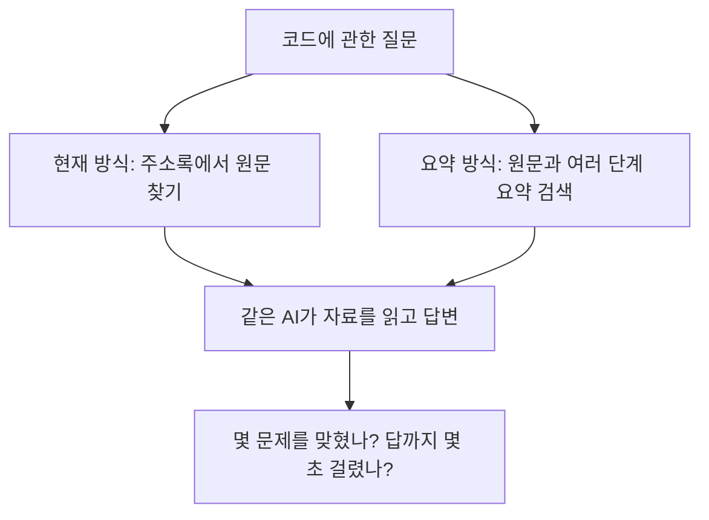

# 코드 주소록에 요약을 더하면 AI가 더 잘 답할까?

**프로젝트를 처음 접하는 사람을 위한 짧은 실험 보고서**  
실험일: 2026년 10월 20일 · 문서 개정일: 2026년 10월 24일

## 1. 먼저, 무엇을 하는 프로젝트인가?

이번에 평가한 부분은 AI가 프로그램 코드를 찾아 읽도록 돕는 기능이다. 예를 들어 “재고를 예약한 뒤 몇 개가 남는가?”라는 질문에 답하려면, 계산 코드뿐 아니라 다른 파일에 있는 안전재고 규칙도 찾아야 한다.

| 개념 | 쉽게 이해하면 |
|---|---|
| **함수** | 계산이나 특정 작업을 수행하는 코드 한 단위 |
| **원문** | 프로그램에 실제로 작성된 코드. 요약 설명의 근거가 된다. |
| **symbol_index** | 함수 등의 이름과 위치를 적은 **코드 주소록**. 필요한 원문이 어디 있는지 찾는다. |
| **RAPTOR** | 작은 내용을 요약하고, 그 요약을 다시 묶어 더 넓은 내용의 요약을 만드는 방법. 이번에는 함수 → 파일 → 프로젝트 순서로 요약했다. |

이번 질문은 **“주소록에서 원문을 찾는 현재 방식보다, 원문과 여러 단계의 요약을 함께 검색하면 더 정확하게 답할까?”**이다. 답변하는 AI는 같게 두고, AI에게 찾아 주는 자료를 바꿨다.

이번 구현은 RAPTOR의 계층 요약 아이디어를 코드에 맞춘 변형이다. 원래 RAPTOR의 모든 검색 기술을 재현한 실험은 아니다.

## 2. 무엇을 비교했고, 결과는 어땠나?

먼저 다섯 검색 방식을 비교했고, 이어서 요약 방식의 속도를 개선하는 실험을 했다. **첫 실험에서는 원문 검색이 48문제 중 12개, 계층 요약 검색이 9개를 맞혀 요약의 이점을 확인하지 못했다.** 아래는 후속 실험의 새 48문제 결과다.

| 방식 | AI에게 보여 주는 자료 | 맞힌 문제 | 답변까지 걸린 시간 |
|---|---|---:|---:|
| **현재 색인** | 주소록에서 고른 함수와 같은 파일의 관련 원문 | 9 / 48 | **2.38초** |
| **계층 요약** | 검색으로 고른 원문 + 함수·파일·프로젝트 요약 | 10 / 48 | 4.39초 |
| **계층 요약 정리** | 바로 위와 같은 자료에서 반복 코드와 긴 출처 표기를 정리 | 11 / 48 | 3.82초 |

가격·권한·재고 등 6개 작은 예제 프로그램을 사용했다. 질문은 영어이며, 각 문제를 세 번 실행했다. 시간은 문제마다 세 번 중 중간 값을 고른 뒤 평균했다. 정답은 실제 코드의 값과 반환 형식까지 맞아야 한다. 모델 시작과 요약 준비 시간은 제외했다.

표에서 읽어야 할 핵심은 세 가지다.

- **요약을 더하니 1문제를 더 맞혔지만 약 2초 더 걸렸다.** 이 정도 정답 차이로 더 정확한 방식이라고 확정하기에는 평가 규모가 작다.
- **반복을 정리하면 요약 방식은 13.1% 빨라졌다.** 다만 현재 색인보다 여전히 60.6% 더 오래 걸렸다.
- **현재 색인이 가장 빠르고, 정확도 우열은 아직 불확실하다.** 정리 방식의 11개 정답도 확실한 우승을 의미하지 않는다.

## 3. 답변이 달라진 모습을 보면

재고 9개 중 1개가 이미 잡혀 있고, 안전재고 3개는 남겨 둬야 한다. 따라서 팔 수 있는 수량은 5개다. 고객이 8개를 요청하되 일부만 예약해도 된다고 했으므로 5개를 예약한다. **예약 뒤 팔 수 있는 수량은 0개**가 정답이다.

| 현재 색인의 답 | 계층 요약의 답 | 계층 요약 정리의 답 |
|---:|---:|---:|
| 8개 · 오답 | 5개 · 오답 | **0개 · 정답** |

이 사례에서는 정리가 도움이 됐다. 하지만 전체로 보면 정리 후 **2문제는 맞게, 1문제는 틀리게** 바뀌었다. 같은 내용이 남아 있어도 반복과 표시 방법이 달라지면 AI의 답도 달라질 수 있다.

## 4. 지금 무엇을 선택해야 하나?

**이번 결과만으로 현재 방식을 요약 방식으로 바꿀 근거는 부족하다.** 속도는 현재 방식이 앞섰고, 요약을 추가한 정확도 이득은 확실하지 않았다. 요약 방식을 계속 개발한다면 반복 자료 정리는 유망한 속도 개선 후보다.

다만 이번 평가는 실제 대형 프로젝트가 아니라 구조가 비슷한 작은 예제 6개에서 이루어졌다. 새 문제도 같은 예제에서 만들었다. 가장 높은 점수도 48문제 중 11개였고, 요약에는 실제 코드와 다른 설명도 발견됐다. 실사용 판단에는 새로운 실제 프로젝트와 한국어 질문을 포함한 추가 검증이 필요하다. 요약 121개를 미리 만드는 데 든 약 **9.5분**도 별도 비용이다.

## 이전 문서의 A·B·C·R0·RF·RH는 무엇이었나?

이 글자는 기술 이름이 아니라 **실험 방식을 구별하기 위한 표기**였다. 본문은 아래의 설명 이름을 사용한다.

| 이전 표기 | 뜻 |
|---|---|
| A | **현재 색인:** 함수 주소록에서 원문 찾기 |
| B | **파일 간 확장:** 현재 방식에서 다른 파일의 관련 원문까지 가져오기 |
| R0 — 숫자 0 | **원문 검색:** 단어 유사도로 원문만 검색하기 |
| RF | **함수 요약:** 원문 검색에 함수 수준의 요약 추가하기 |
| RH | **계층 요약:** 원문 검색에 함수·파일·프로젝트 요약 추가하기 |
| C | **계층 요약 정리:** 계층 요약 방식이 고른 자료의 반복과 출처 표기를 줄이기 |

수치의 근거: [1차 실험 결과](evidence/analysis.json), [후속 실험 결과](evidence/revision_v2/summary_v2.json). 실험 조건·정답 차이의 불확실성·실제 답변 사례를 더 확인하려면 [상세 보고서](01_symbol_index와_RAPTOR_실험설계와_결과.md)를 참고하면 된다.
